<div align="center">



<h3>A topic in, a finished animated explainer out.<br/>Script, voice, per-word timing, visuals — free and local.</h3>

[](https://github.com/sandalkuilang/dalang/releases/latest)
[](https://github.com/sandalkuilang/dalang/actions/workflows/ci.yml)
[](LICENSE)
[](https://claude.com/claude-code)

</div>

## Install

```bash
git clone https://github.com/sandalkuilang/dalang ~/.claude/skills/dalang
```

Pin a release instead: `git clone --branch v4.5.2 --depth 1 https://github.com/sandalkuilang/dalang ~/.claude/skills/dalang`

Restart Claude Code, check your machine once, then ask in any language:

```bash
node ~/.claude/skills/dalang/scripts/preflight.mjs
```

```
"make a 45 s YouTube Short about why steel ships float"
"haz un video de 90 s sobre la fotosíntesis"
```

## How it works

<picture>
  <source media="(prefers-color-scheme: dark)" srcset="docs/assets/pipeline.dark.svg">
  
</picture>

<picture>
  <source media="(prefers-color-scheme: dark)" srcset="docs/assets/timing.dark.svg">
  
</picture>

- **Words first.** The voice is recorded before any frame exists; every cut lands on a timed word, with room before the first word and after the last, and a free music bed under it.
- **Two lanes, two looks.** Express or Studio (below); looks `isometric-world` (with `cutaway` and `blueprint` beats) or `object-studio` 3D, in either lane; the camera is a slow one-way orbit.
- **Hands-off.** All questions up front; the agent passes its own gates and hands you the film with its metrics.
- **Lean.** Parallel builders on a code-written frame, small subagents, measured tokens.

## Express or Studio

<picture>
  <source media="(prefers-color-scheme: dark)" srcset="docs/assets/lanes.dark.svg">
  
</picture>

The Brief asks once; both run hands-off after it.

| | **Express** (default, fast lane) | **Studio** (precision lane) |
|---|---|---|
| Pick it for | a 30–90 s explainer, ready in about 20 minutes of work | a subject that must look exactly like the real thing, opened up |
| The subject | drawn as true shapes (isometric), or a model already in your library | modelled once from your 2D pictures as a Blender script, kept in your library for later films |
| Engines | voice: VoiceStudio or Kokoro · scene: **Canvas 2D** (`engine/iso`); `object-studio`: **three.js** · video: **HyperFrames** + ffmpeg | voice: VoiceStudio or Kokoro · subject: **Blender** (`engine/blender`) · scene: **three.js** (`engine/three`) · video: **HyperFrames** + ffmpeg |
| You give | the topic (photos, a datasheet or manual, the model name: optional) | the topic and 3–5 pictures of the subject (photos, a cutaway diagram, a manual page) |
| You get | `final.mp4` (one render), captions, `POST.md`, metrics | `final.mp4` (high render), captions, `POST.md`, metrics, the subject asset for reuse |

**Express workflow**
1. Preflight and every Brief question at once.
2. Facts, then the script, each a subagent job; Gate 1 runs the lints itself.
3. The voice take, one subagent job; a clean take is padded and captioned (Gate 2).
4. One planner writes `SPEC.md` and the storyboard, then scaffolds the shot groups.
5. Builders fill the groups in parallel; one assemble check (Gate 3).
6. One render, Gate 4, the film.

**Studio workflow**
1. Preflight and every Brief question at once (Blender asked if missing).
2. Facts, then the script (Gate 1), the voice (Gate 2).
3. The subject: your pictures read into a parts sheet, modelled in Blender, its still checked against the pictures.
4. Look: `SPEC.md`, storyboard, style frames scored by a fresh reviewer (Gate 3).
5. Build: a pilot shot group, then the rest in parallel, the motion posed from its cause (x-ray, section planes, parts turning at their real rate, numbered pins).
6. QC: one check runner, review strips, a reviewer, fix rounds (Gate 4); a high render, the film.

More: [workflow](docs/workflow.md) · [architecture](docs/architecture.md) · [changelog](CHANGELOG.md)

<details>
<summary>Requirements</summary>

| Needed | For | Notes |
|---|---|---|
| Node.js · ffmpeg | everything | `preflight.mjs` says what's missing |
| HyperFrames skills | the build step | `npx hyperframes skills update` |
| VoiceStudio | narration + word timing | free, local; ElevenLabs (paid) only on request |
| Kokoro-82M (`pip install kokoro soundfile torchaudio`, own Python via `DALANG_PYTHON`) | optional commercial-OK local voice (`--engine kokoro`) | the pip install pulls torch, transformers, spaCy and the rest: ~0.3 GB on macOS arm64, ~3 GB on Linux with CUDA wheels; then ~330 MB of weights (+ the ~13 MB spaCy English text model). Apache-2.0, en and en-gb only, asked first |
| Blender (optional) | Studio's hero asset, modelled once by script (`engine/blender`) | GPL; runs on your machine, never shipped; asked first |
| vtracer (optional) | tracing a photo of your own thing (`scripts/trace.mjs`) | MIT, ~2 MB in its own venv; asked first |

</details>

## Licence

A reference film's craft may be measured; its images, script or voice are never reused, and a recorded voice needs its speaker's permission.

[MIT](LICENSE). VoiceStudio's default OmniVoice weights and the ElevenLabs free tier are non-commercial; `check_assets.mjs --commercial` catches them before a monetised render. Credits: [NOTICE](NOTICE).
