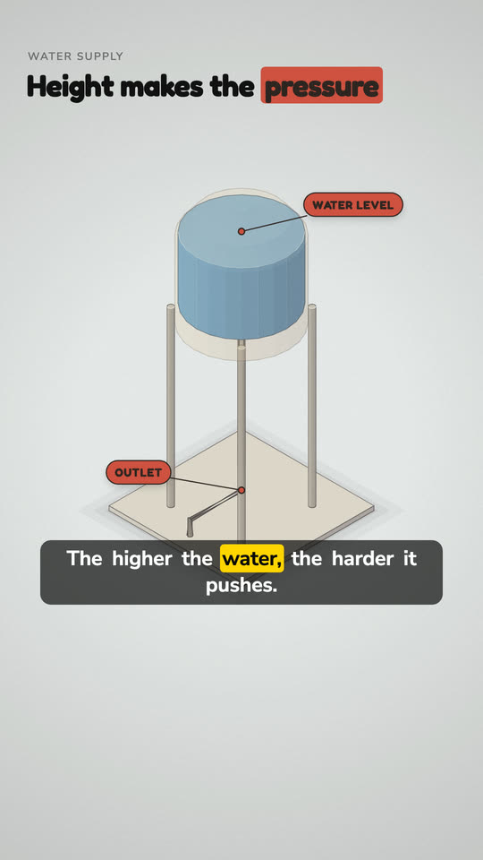
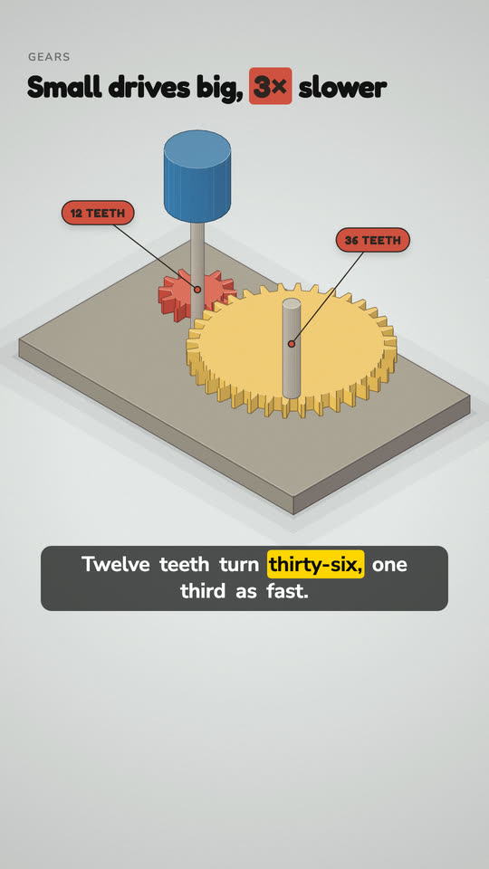
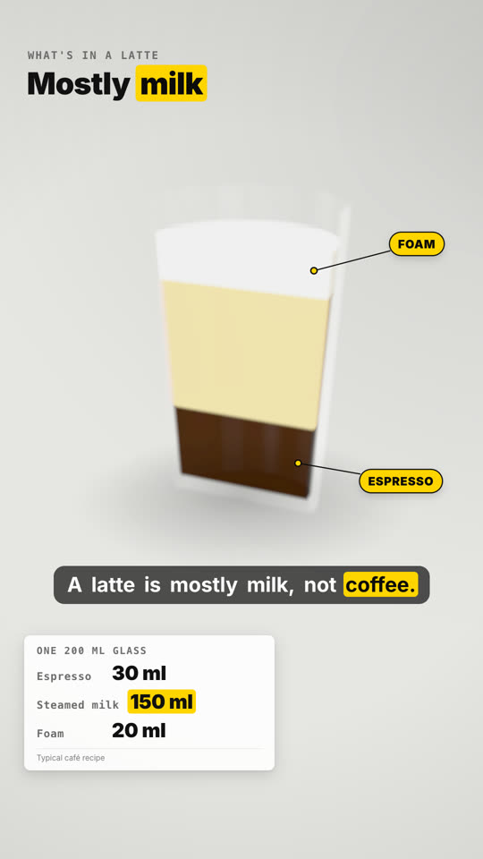
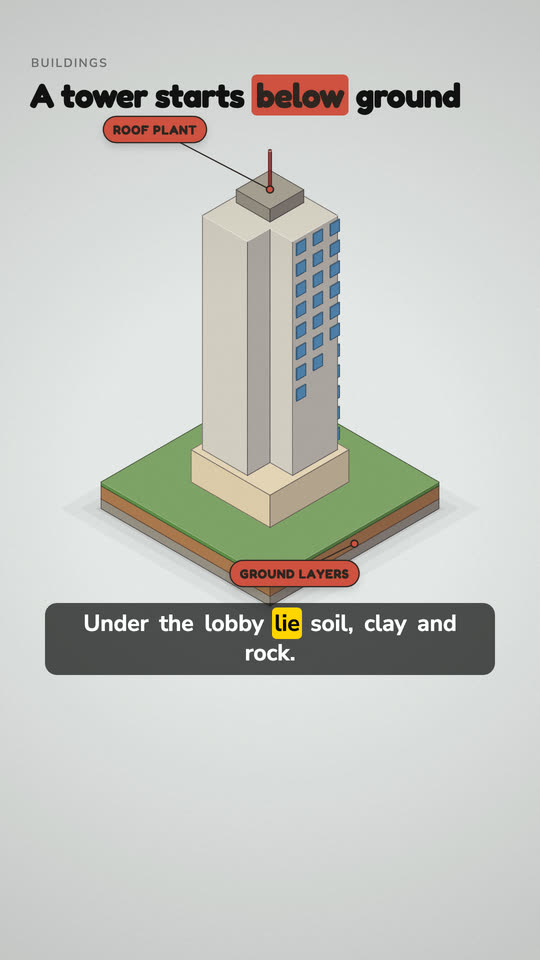
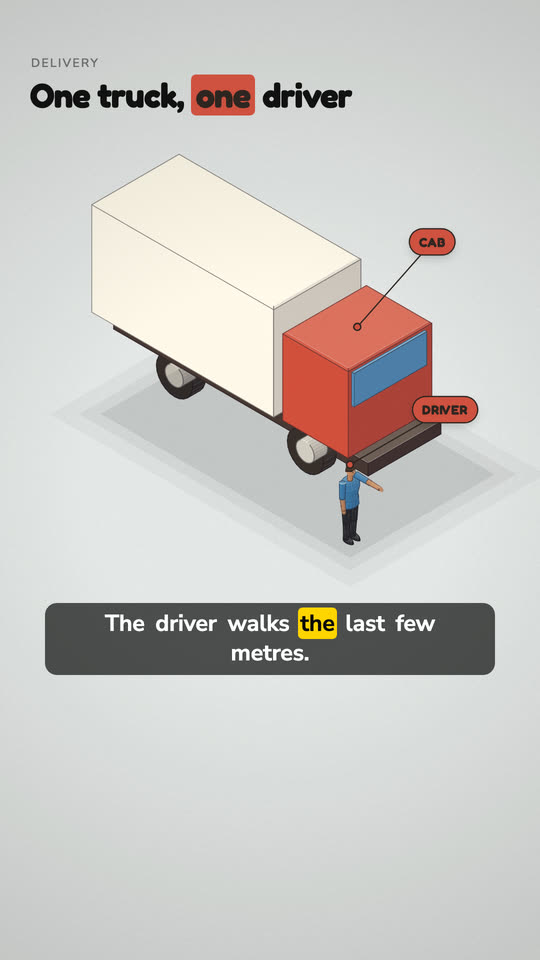

<div align="center">


<h3>A topic in, a finished animated explainer out.<br/>Script, voice, per-word timing, visuals — free and local.</h3>

[](https://github.com/sandalkuilang/dalang/releases/latest)
[](https://github.com/sandalkuilang/dalang/actions/workflows/ci.yml)
[](LICENSE)
[](https://claude.com/claude-code)

</div>

## Samples

<table>
<tr>
<td></td>
<td></td>
<td></td>
<td></td>
<td></td>
</tr>
<tr align="center">
<td><sub>isometric-world · cutaway</sub></td><td><sub>isometric-world · gears</sub></td><td><sub>object-studio · 3D</sub></td><td><sub>isometric-world · ground</sub></td><td><sub>isometric-world · figure</sub></td>
</tr>
</table>

<sub>Single frames from the skill's own engines: four Express stills (`engine/iso`, inked edges and contact shadows) and one `object-studio` still. Every label is pinned to its part and lands on the spoken word.</sub>

## Install

```bash
git clone https://github.com/sandalkuilang/dalang ~/.claude/skills/dalang
```

Pin a release instead: `git clone --branch v3.10.0 --depth 1 https://github.com/sandalkuilang/dalang ~/.claude/skills/dalang`

Restart Claude Code, check your machine once, then ask in any language:

```bash
node ~/.claude/skills/dalang/scripts/preflight.mjs
```

```
"make a 45 s YouTube Short about why steel ships float"
"haz un video de 90 s sobre la fotosíntesis"
```

## How it works

<picture>
  <source media="(prefers-color-scheme: dark)" srcset="docs/assets/pipeline.dark.svg">
  
</picture>

<picture>
  <source media="(prefers-color-scheme: dark)" srcset="docs/assets/timing.dark.svg">
  
</picture>

- **Words first.** The voice is recorded before any frame exists; every cut lands on a timed word, with room before the first word and after the last, and a free music bed under it.
- **Two lanes, two looks.** Express (the default, 20 minutes of work) draws a Canvas 2D isometric world; Studio (the precision lane) builds it in three.js, its hero modelled once from your 2D pictures as a Blender script. Looks: `isometric-world` (with `cutaway` and `blueprint` beats) or `object-studio` 3D, in either lane; the camera is a slow one-way orbit.
- **Hands-off.** All questions up front; the agent passes its own gates and hands you the film with its metrics.
- **Lean.** Parallel builders on a code-written frame, small subagents, measured tokens.

More: [workflow](docs/workflow.md) · [architecture](docs/architecture.md) · [changelog](CHANGELOG.md)

<details>
<summary>Requirements</summary>

| Needed | For | Notes |
|---|---|---|
| Node.js · ffmpeg | everything | `preflight.mjs` says what's missing |
| HyperFrames skills | the build step | `npx hyperframes skills update` |
| VoiceStudio | narration + word timing | free, local; ElevenLabs (paid) only on request |
| Kokoro-82M (`pip install kokoro soundfile torchaudio`, own Python via `DALANG_PYTHON`) | optional commercial-OK local voice (`--engine kokoro`) | the pip install pulls torch, transformers, spaCy and the rest: ~0.3 GB on macOS arm64, ~3 GB on Linux with CUDA wheels; then ~330 MB of weights (+ the ~13 MB spaCy English text model). Apache-2.0, en and en-gb only, asked first |
| Blender (optional) | Studio's hero asset, modelled once by script (`engine/blender`) | GPL; runs on your machine, never shipped; asked first |
| vtracer (optional) | tracing a photo of your own thing (`scripts/trace.mjs`) | MIT, ~2 MB in its own venv; asked first |

</details>

## Licence

A reference film's craft may be measured; its images, script or voice are never reused, and a recorded voice needs its speaker's permission.

[MIT](LICENSE). VoiceStudio's default OmniVoice weights and the ElevenLabs free tier are non-commercial; `check_assets.mjs --commercial` catches them before a monetised render. Credits: [NOTICE](NOTICE).
