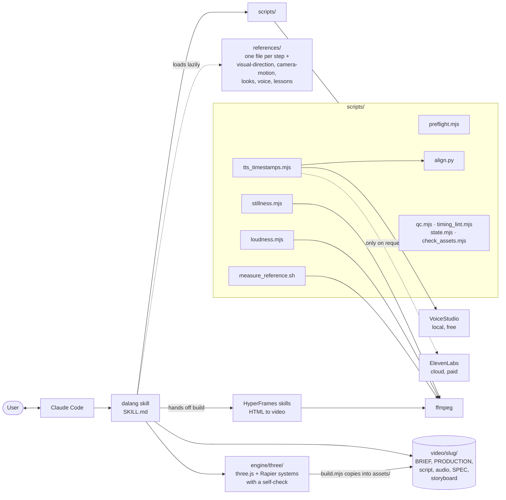

# Architecture

Dalang is orchestration, not rendering. It owns the *process*; specialist tools own the *pixels* and the *voice*.

## Responsibilities

| Component | Owns | Does not |
|---|---|---|
| `SKILL.md` | order of work, gates, quality bar | build animations |
| `references/` | craft knowledge, read one § at a time | get loaded wholesale |
| `scripts/preflight.mjs` | environment check, ~15 lines of output; `--start` opens an installed VoiceStudio | install anything, print secrets |
| `scripts/tts_timestamps.mjs` | narration audio, `words.json`, `beats.json/js` | decide the look |
| `scripts/align.py` | word timing against the known script (Apache-2.0 CTC models) | download a model without asking |
| `scripts/stillness.mjs`, `loudness.mjs`, `qc.mjs`, `timing_lint.mjs` | measured QC (stillness, LUFS / true peak, black frames, colour tags, cuts inside words) | judge taste |
| `scripts/state.mjs`, `check_assets.mjs` | gate approvals (stale on change), licence gate + `CREDITS.md` | approve on the user's behalf outside autonomous mode |
| `engine/three/` | generic 3D systems (real scale and settling, surfaces, physics, cloth, air, plants, particles, water, fur), each with a self-check; `bake.mjs` stores a physics bake once for every snapshot and render worker; ready pieces in `examples/` | know a scene, a topic or a list of objects |
| fresh-eyes reviewer (`references/review.md`) | a defect list from a subagent with no build history | fix anything |
| HyperFrames skills | scene building, preview, render | pick the script or voice |
| Project files | all state (one video = one session) | live in the skill repo |

## Design decisions

- **State in files, not chat.** Resume from `BRIEF.md` + last lines of `PRODUCTION.md`; keeps sessions short and cheap.
- **Lean `SKILL.md`, details in `references/`.** Each step names the one § it needs.
- **Measure, don't guess.** Duration, cost, stillness and loudness come from script output, never from memory.
- **Secrets stay in the shell.** The ElevenLabs key is read from `ELEVENLABS_API_KEY`, never printed or written to a project file.
- **The 3D engine grows by behaviours, not objects.** Any model is a body from its own mesh and its looked-up mass and friction; a new law (a liquid, an orbit, an ion in a field) is built generic, self-checked, proved in a render, then added.
- **Engines are swappable.** Both voice engines produce the same outputs, so later steps don't care which one ran.

See [`references/lessons.md`](../references/lessons.md) for the real failures that shaped each rule.
