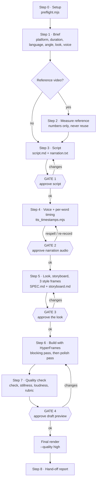
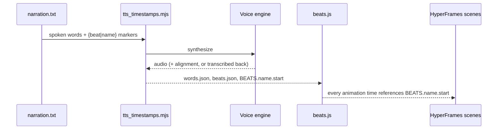

# Workflow

Nine steps, four approval gates. Nothing renders at final quality before Gate 4.

## Pipeline

## What each step produces

| Step | Output | Gate |
|---|---|---|
| 0 Setup | one-line preflight result in `PRODUCTION.md` | — |
| 1 Brief | `BRIEF.md` | — |
| 2 Reference (optional) | `reference-measurements.md` (numbers only) | — |
| 3 Script | `script.md`, `narration.txt` with `{beat\|name}` markers | **1** |
| 4 Voice | `audio/narration.*`, `words.json`, `beats.json`, `beats.js` | **2** |
| 5 Look | `SPEC.md`, `storyboard.md`, `style-frames/` (3 stills) | **3** |
| 6 Build | HyperFrames composition; every time = `BEATS.<name>.start` | — |
| 7 QC | `draft.mp4`, stillness ≤ 10 %, ≈ −14 LUFS, review snapshots | **4** |
| 8 Hand-off | final file + honest numbers from `PRODUCTION.md` | — |

## Why timing drives everything

Never hard-code seconds in a scene: change the script, regenerate, and the visuals follow.

## Cheap before expensive

| Instead of | Do |
|---|---|
| Full voice generation | `--sample` first |
| Re-synthesising | `--from-response` when only `{}` markers moved |
| Re-recording for a small pace miss (< 10 %) | `--speed` |
| Full renders while iterating | snapshots at beat times, `--quality draft` until Gate 4 |

## Autonomous mode

Given only a topic, the skill uses defaults (16:9, 60–90 s, user's language, modern balanced energy), logs "defaults used" in `PRODUCTION.md`, passes the gates on its own judgement and stops at a draft that passes Step 7. The final render happens only if the user said "just finish it" up front.

## CI

`.github/workflows/ci.yml` runs a syntax check on every script and verifies `SKILL.md` front-matter on each push and PR.
