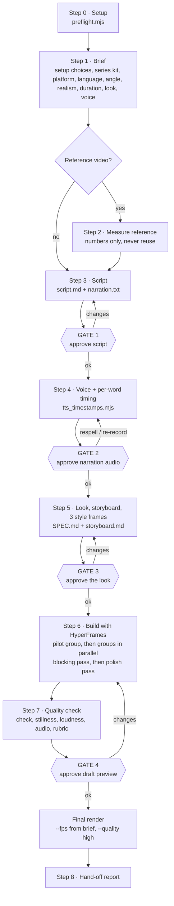
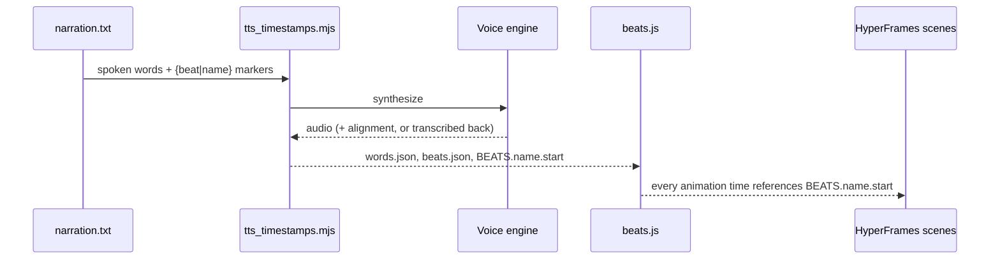

# Workflow

Nine steps, four approval gates. Nothing renders at final quality before Gate 4.

## Pipeline

## What each step produces

| Step | Output | Gate |
|---|---|---|
| 0 Setup | one-line preflight result in `PRODUCTION.md` | — |
| 1 Brief | `BRIEF.md` (pre-filled by a series kit) | — |
| 2 Reference (optional) | `reference-measurements.md` (numbers only) | — |
| 3 Script | `script.md`, `narration.txt` with `{beat\|name}` markers; every number tagged; `model.mjs` → `numbers.json` for `[calc]` numbers (`numbers_lint.mjs`) | **1** |
| 4 Voice | `audio/narration.*`, `words.json`, `beats.json`, `beats.js` | **2** |
| 5 Look | `SPEC.md`, `storyboard.md` (`storyboard_lint.mjs`), `style-frames/` (3 stills) | **3** |
| 6 Build | HyperFrames composition: a pilot shot group, then the other groups built in parallel subagents as sub-compositions (`compositions/<group>.html`) and assembled in `index.html`; every time = `BEATS.<name>.start` | — |
| 7 QC | `draft.mp4`, stillness ≤ 10 %, ≈ −14 LUFS, `audio_qc.mjs` flags 0 (an exit 2 is named in the hand-off), scopes (numbers), review strips (`strips.mjs`), sound-off quiz | **4** |
| 8 Hand-off | final file, `POST.md` (post description) + honest numbers from `PRODUCTION.md` | — |

Before each step the agent runs `node <skill-dir>/scripts/state.mjs next`: it works out the step from the project's
files and prints only that step's reading list (sections as `sed` commands, the step's lesson headlines), then a
"look up when needed" index (one heading and `sed` command per section the step points to, no body). The gate counts
what is printed to read (sections and lesson headlines) against 60 KB for Steps 0–8; every indexed section still has
to exist and fit 8 KB, and `tests/reading.mjs` fails when any section of a reference is over 8 KB or a pointer in the
step's text has no index line. Images
(stills, strips, contact sheets) are read by subagents that return a text verdict, never in the main context. Each subagent job has a model: the strongest for the jobs that judge the film, a mid tier for fix checks, asset pair checks, media screening and research (`SKILL.md` "Work fast").

## Why timing drives everything

Never hard-code seconds in a scene: change the script, regenerate, and the visuals follow.

## Cheap before expensive

| Instead of | Do |
|---|---|
| Full voice generation | `--sample` first |
| Re-synthesising | `--from-response` when only `{}` markers moved |
| Re-recording for a small pace miss (< 10 %) | `--speed` |
| Calmer or faster delivery of an approved take | `--tempo` on `--from-response` |
| Full renders while iterating | snapshots at beat times, `--quality draft` until Gate 4 |

## Autonomous mode

(A test run the user names as a test or draft gets one review round, lean; autonomous mode alone never does.)

Given only a topic, the skill uses defaults (16:9, 60–90 s — 9:16 when a short is asked for — user's language, modern balanced energy), logs "defaults used" in `PRODUCTION.md`, passes the gates on its own judgement and stops at a draft that passes Step 7. A fresh-eyes reviewer subagent stands in for the human eye. The final render happens only if the user said "just finish it", in any language.

## CI

`.github/workflows/ci.yml` runs a syntax check on every script and verifies `SKILL.md` front-matter on each push and PR.
