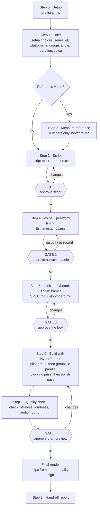
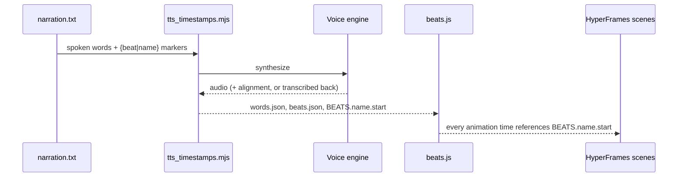

# Workflow

Nine steps, four gates (the agent passes each once its checks pass). Nothing renders at final quality before Gate 4.

## Pipeline

## What each step produces

| Step | Output | Gate |
|---|---|---|
| 0 Setup | one-line preflight result in `PRODUCTION.md` | — |
| 1 Brief | `BRIEF.md` (pre-filled by a series kit); every question of the run is asked here, in English, back to back (setup consents, mode, platform, language, angle, duration, energy, audience, voice, extras such as the second-language cut), so the user can leave afterwards | — |
| 2 Reference (optional) | `reference-measurements.md` (numbers only) | — |
| 3 Script | `script.md` (opens with `Promise:` and `Takeaway:`), `narration.txt` with `{beat\|name}` markers, followable by ear (one idea within a word budget, the voice says why while the picture shows what; `narration_lint.mjs`, text-only read-through); every number tagged; `model.mjs` → `numbers.json` for `[calc]` numbers (`numbers_lint.mjs`) | **1** |
| 4 Voice | `audio/narration.*`, `words.json`, `beats.json`, `beats.js` | **2** |
| 5 Look | `SPEC.md`, `storyboard.md` (`storyboard_lint.mjs`), `style-frames/` (3 stills), built from `review/refs-board-*.jpg` | **3** |
| 6 Build | HyperFrames composition: builder subagents only, writing the set and its shot data (`shots.js`) rather than per-shot code: a pilot shot group, then the other groups built in parallel as sub-compositions (`compositions/<group>.html`) and assembled in `index.html`; every time = `BEATS.<name>.start` | — |
| 7 QC | `draft.mp4`, stillness ≤ 10 %, ≈ −14 LUFS, `audio_qc.mjs` flags 0 (an exit 2 is named in the hand-off), scopes (numbers), review strips (`strips.mjs`), sound-off quiz | **4** |
| 8 Hand-off | final file, `POST.md` (post description) + honest numbers from `PRODUCTION.md`; optional second-language cut: `final.<lang>.mp4` + `narration.<lang>.srt` (same storyboard, `beats_lint.mjs`) | — |

Before each step the agent runs `node <skill-dir>/scripts/state.mjs next`: it works out the step from the project's
files and prints only that step's reading list (with `--print` the sections' text in one call, else `sed` commands; the step's lesson headlines), then a
"look up when needed" index (one heading and `sed` command per section the step points to, no body). The gate counts
what is printed to read (sections and lesson headlines) against 60 KB for Steps 0–8; every indexed section still has
to exist and fit 8 KB, and `tests/reading.mjs` fails when any section of a reference is over 8 KB or a pointer in the
step's text has no index line. Images
(stills, strips, contact sheets) are read by subagents that return a text verdict, never in the main context (the one exception: the author of `style-frames/src/`, the main agent or a builder, opens each Step 5 `review/refs-board-<frame>.jpg` once before its first write). The film's scene code is too (the Step 5 style frames excepted): builder subagents write the pilot, the groups, the assembly and each QC fix round, and return a short report (`look-build.md` "Parallel build"). Each subagent job has a model and an effort, picked from one table and never asked: the top model for the jobs that judge the film (high effort) and the Studio builders (high for the pilot, medium after), a mid tier for Express builders, research, fix checks and asset pair checks, a light tier for text-only media screening. A job that fails its own check is replaced one notch up (effort first, then model), never repeated at the same setting (`SKILL.md` "Work fast").

## Why timing drives everything

Never hard-code seconds in a scene: change the script, regenerate, and the visuals follow.

## Parallel lanes

Anything with no input from another job starts in the same message; only heavy jobs (voice, render, check, snapshot) run one at a time.

| Step | Together |
|---|---|
| 0–1 | `preflight.mjs` in the background, with the first Brief question |
| 2–3 | reference measurement, and fact research split into strands, one agent each |
| after Gate 1 | the voice take, `SPEC.md` + `storyboard.md` (from Gate 2, by the planner, both modes), assets, music, OBJECTS stills |
| 6 | Studio: pilot, then every group at once. Express: one builder under 45 s, 2 at once from 45 s, 3 above 75 s |
| 7 | the read-only scripts on the draft; then the reviewer, the sound-off quiz and the second Set / Reality check |
| 8 | `POST.md` while the final render runs |

## Cheap before expensive

| Instead of | Do |
|---|---|
| Full voice generation | `--sample` first |
| Re-synthesising | `--from-response` when only `{}` markers moved |
| Re-recording for a small pace miss (< 10 %) | `--speed` |
| Calmer or faster delivery of an approved take | `--tempo` on `--from-response` |
| Full renders while iterating | snapshots at beat times, `--quality draft` until Gate 4 |

## Autonomous mode

(A test run the user names as a test or draft gets one review round, lean; autonomous mode alone never does.)

Given only a topic, the skill uses defaults (16:9, 60–90 s — 9:16 when a short is asked for — user's language, modern balanced energy), logs "defaults used" in `PRODUCTION.md`, passes the gates itself and runs to the finished film. A fresh-eyes reviewer subagent stands in for the human eye.

## CI

`.github/workflows/ci.yml` runs the merge gate (`scripts/gate.sh`: syntax, `SKILL.md` front-matter, diagrams, the engine build and self-check, every test in `tests/`) on each push and PR.
